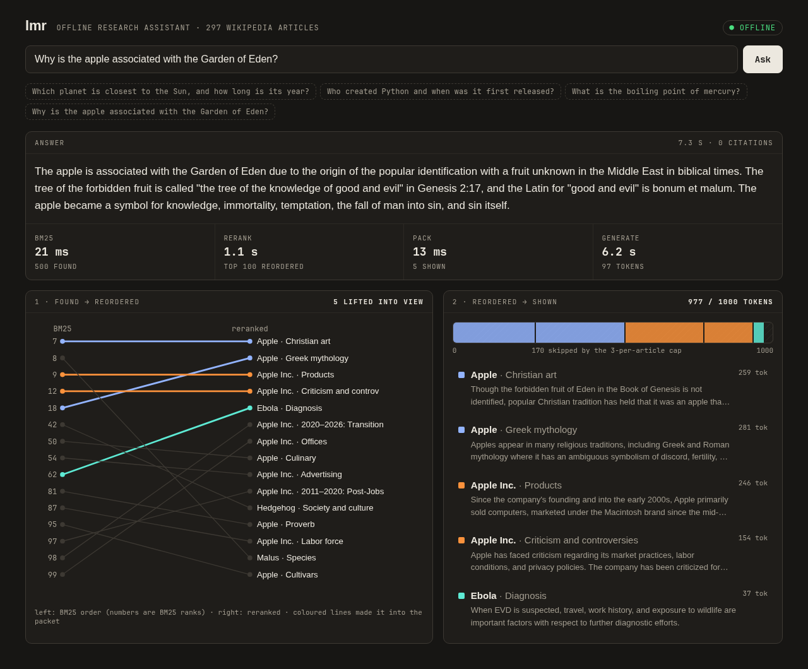
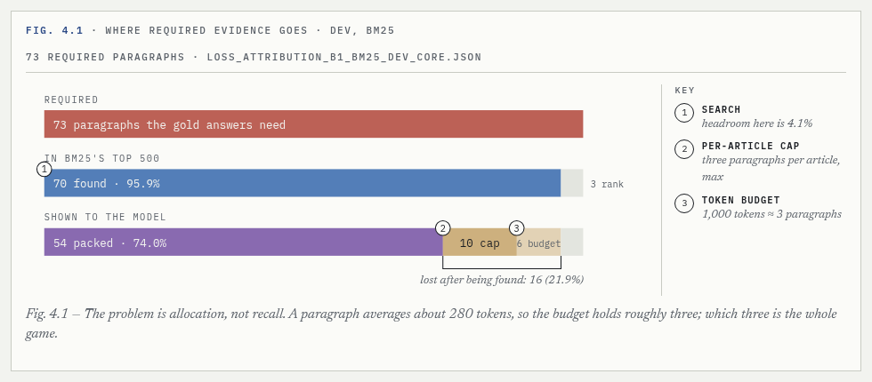

# lmr

**An offline research assistant that shows its work.** Ask a question about 297 Wikipedia articles. Keyword search finds the evidence, a 17M reranker decides what fits in a 1,000-token budget, and a local 1.5B model writes the answer. On a desktop CPU it answers in about 5 s once warm (`lmr serve` keeps the models loaded); a cold one-off `lmr ask` took 11.6 s wall, because it also loads the index, reranker and model. No network after setup.



## The finding behind it

The project started as an entry idea for an [offline Android research-app bounty](https://poidh.xyz/mainnet/bounty/31). Before building an app, it asked whether better retrieval actually matters on a phone-sized model. It doesn't, but better *packing* does.



- **Search was already good.** BM25 found 96% of the paragraphs the questions needed.
- **The loss happened after search.** About a quarter of what was found never fit in the budget given to the model.
- **The model that helped was an allocator, not a searcher.** A 17M cross-encoder found nothing new. It reordered what BM25 had, and 13 points more of the needed evidence reached the model (pooled across 195 required paragraphs, with non-overlapping 95% intervals).
- **The 68M reranker was not worth it.** It added one paragraph over the 17M for 3.9× the weights.
- **The generator is now the bottleneck.** Even with perfect evidence, the 1.5B model gets 14.6% exact match.

The full story, with figures, is in the **[Technical Manual (PDF, 19 pages)](docs/manual/pdf/manual.pdf)**. Its source is [`docs/manual/index.html`](docs/manual/index.html), and its data figures are drawn from benchmark JSON by `docs/manual/build_figures.py`.

## Run it

Linux x86-64, Python 3.11+, [uv](https://docs.astral.sh/uv/). No GPU needed.

```sh
git clone https://github.com/davidghatley/local-mobile-research && cd local-mobile-research
uv venv
# The reranker needs torch. Install the CPU build first, or pip pulls the multi-GB CUDA wheels:
uv pip install torch --index-url https://download.pytorch.org/whl/cpu
uv pip install -e ".[rerank]"
.venv/bin/lmr setup      # llama.cpp (CPU) + Qwen2.5-1.5B GGUF, hash-checked; corpus from 297 pinned revisions
.venv/bin/lmr ask "Which planet is closest to the Sun, and how long is its year?"
.venv/bin/lmr serve      # http://127.0.0.1:8765
```

Install from a clone (editable, as above). A plain `pip install` from a git URL is not supported: the corpus build script and provenance pins live in the repo checkout, not in the package.

Sample `lmr ask` output (warm timings, desktop CPU):

```
Mercury is the closest planet to the Sun, and its sidereal year is 88 Earth days.

evidence (692/1000 tokens, 1 paragraph):
 ○ [p:mercury_planet:00:000] Mercury (planet) — (lead)

bm25 20 ms · rerank 1466 ms · generate 3433 ms · offline
```

(The model cited no paragraph here, so the dot is open; see Limits.)

## Run the tests

```sh
uv pip install -e ".[dev]"
.venv/bin/pytest          # runs tests/ only; about 470 pass, the rest skip when pinned artifacts are absent
```

Plain `pytest` collects only `tests/` (set in `pyproject.toml`). The project's own 10-stage gate is `scripts/verify_round0`.

| Command | Does |
|---|---|
| `lmr ask "…" [--json] [--rerank-k 50] [--no-rerank]` | Answer one question in the terminal |
| `lmr serve [--port 8765]` | Local web UI; `/?q=…` links open straight to an answer |
| `lmr bench [--split dev\|shadow_dev] [--k 0 20 50 100 500]` | Evidence completion and latency against rerank depth |

`lmr setup` downloads about 1.1 GB once (into `~/.cache/lmr`). After that, the language model runs as a `llama-server` on `127.0.0.1`, and nothing else uses the network. Requires Linux x86-64 and Python 3.11+. No GPU needed.

## How it was built

This was an AI-agent-built research project run under a strict protocol:
- thresholds and kill conditions were preregistered before any code;
- a sealed test set was kept outside the repo;
- every subagent ran on a free model;
- eight independent freeze reviews were held, and seven sent the work back for repairs.

What I decided and what the agents did is spelled out in the manual's Appendix A. The research record is in [`docs/RESEARCH.md`](docs/RESEARCH.md), with `scripts/verify_round0` as its 10-stage freeze gate and 518 tests behind it.

```
lmr/           the app: corpus rebuild, runtime, pipeline, CLI, web UI
substrate/     frozen research contracts: query, evidence packets, prompt, splits
eval/          scoring
experiments/   BM25, packer, baselines and round-1 results
docs/manual/   the illustrated manual (HTML + PDF) and its data
```

## Limits

- **Desktop only.** There is no Android build, and no number here is a phone measurement.
- **Weak generator.** The 1.5B model rarely emits citations and can add facts that aren't in its evidence; the UI shows which paragraphs it actually cited. The next step is a small fine-tune for cited answers.
- **Fixed corpus.** It covers 297 articles. Importing your own documents is the obvious next feature.

Text: Wikipedia, CC BY-SA 4.0. Models: [ettin-reranker-17m](https://huggingface.co/cross-encoder/ettin-reranker-17m-v1), [Qwen2.5-1.5B-Instruct](https://huggingface.co/Qwen/Qwen2.5-1.5B-Instruct) (Apache-2.0), run with [llama.cpp](https://github.com/ggml-org/llama.cpp).
